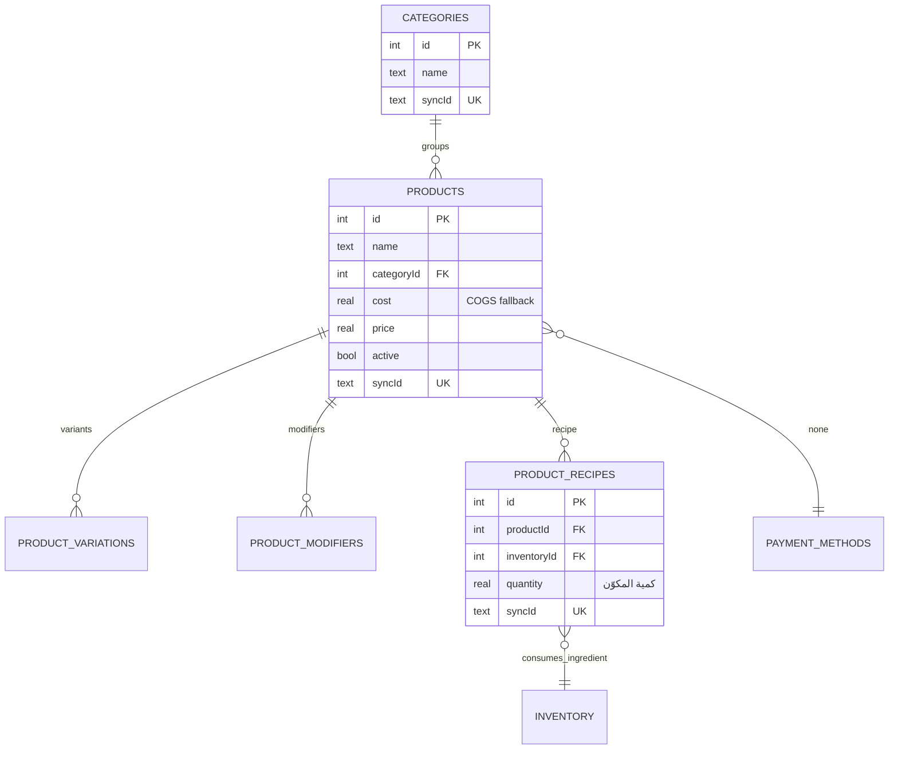
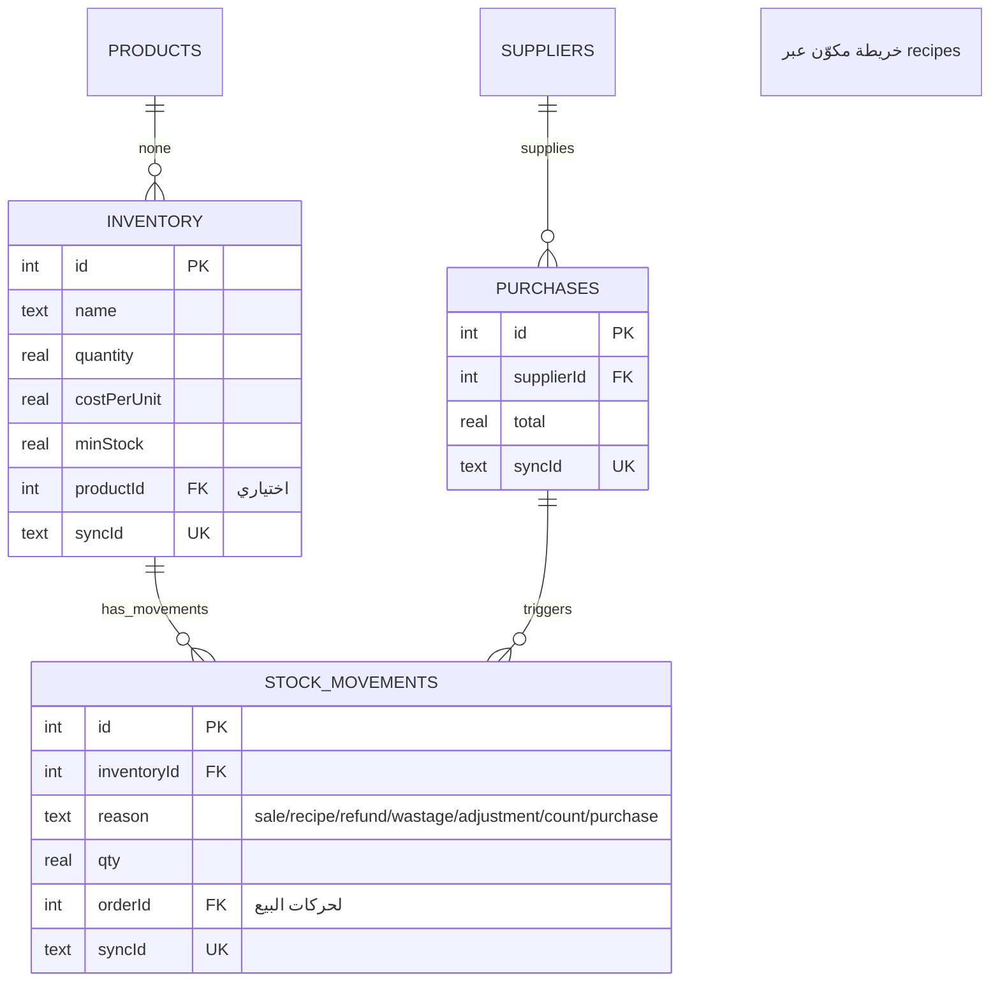
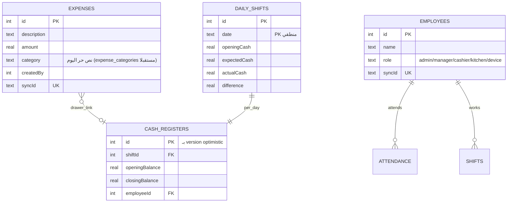
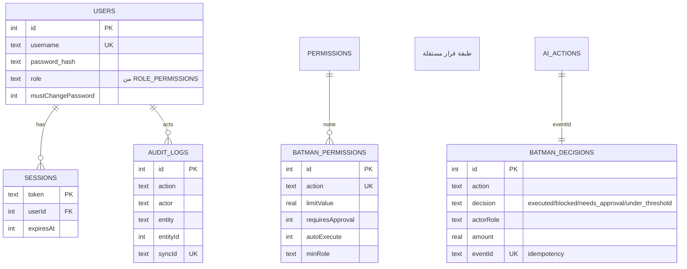

# نموذج البيانات (Data Model) — Contract

> المستند: `docs/DATA_MODEL.md` — مخرج Phase 1.
> الحالة: وصف. يوثّق الكيانات والعلاقات الصحيحة **من الـ schema الفعلي** (`backend/schema/schema.sql` + migrations) + IndexedDB (`SYNC_STORES`).
> **لم يُنفَّذ أي تغيير schema — هذا المستند مرجع وقررات ترحيل فقط.**

---

## 1) مجموعات المخططات (ER — Mermaid)

### 1.1 المالية (Sales/Payments/Refunds)

```mermaid
erDiagram
    ORDERS ||--o{ ORDER_ITEMS : contains
    ORDERS ||--o{ PAYMENTS : settled_by
    ORDERS ||--o{ REFUNDS : refunded_by
    ORDERS ||--o{ ORDER_STATUS_HISTORY : has_history
    PAYMENTS }o--|| PAYMENT_METHODS : method
    REFUNDS }o--o| PAYMENTS : original_payment (nullable)

    ORDERS {
        int id PK
        text orderNumber UK
        text orderType
        text status "pending..closed"
        text paymentStatus "pending/paid/refunded"
        real subtotal
        real discount
        real discountAmount
        real tax "= 0 (قرار إداري)"
        real total
        real totalPaid
        int tableId FK
        text syncId UK
    }
    ORDER_ITEMS {
        int id PK
        int orderId FK
        text orderSyncId "رابط مستقر للأب"
        int productId FK
        real quantity
        real unitPrice
        real total
        text syncId UK
    }
    PAYMENTS {
        int id PK
        int orderId FK
        text orderSyncId
        text paymentSyncId UK "idempotency (split ثابت)"
        text method
        real amount
    }
    REFUNDS {
        int id PK
        int orderId FK
        int paymentId FK
        real amount
        text type "full/partial"
        text reason
        text refundMethod
    }
```

### 1.2 الكتالوج (Products)



### 1.3 المخزون والموردون



### 1.4 المصروفات والأطراف



### 1.5 النظام والأمان



---

## 2) حقول الهوية المستقرّة (كل الكيانات المزامَنة)

| الحقل | الغرض |
|---|---|
| `syncId` (UNIQUE لكل جدول) | الهوية المستقرة عبر أجهزة/طرق |
| `updatedAt` | newestWins |
| `orderSyncId` (order_items/payments) | ربط مستقر مع الأب |
| `paymentSyncId` (payments) | idempotency لفعل الدفع/الدفعة split |
| `eventId` (batman_decisions/ai_actions) | idempotency للأدوات/التدقيق |
| `_synced/_device_id/_synced_at` (الوضع السحابي) | أثر sync-engine |

---

## 3) الحقول المحمية (لا قابلة للتعديل عبر sync)

`ORDER_MONEY_IMMUTABLE = ['totalPaid','paidAmount','changeAmount','paymentMethod','paymentMethodId']` (`crud.ts:89`) — الماليات تُعدَّل عبر العمليات المالية فقط (checkout/void/refund)، لا عبر sync/CRUD عام.

---

## 4) جداول حية غير موجودة في schema.sql (من migrations)

`sessions, table_locks, schema_migrations, batman_permissions (001), batman_decisions (002), backup_log (003), eventId (004), stock_movements.orderId (005)`.

---

## 5) جداول مقترحة للترحيل (Phase 5-8 — **لا تُنشأ الآن**، توثيق فقط)

| الجدول | الغرض | ملاحظة |
|---|---|---|
| `expense_categories` | تصنيف المصروفات (+ `expenses.categoryId` FK) | **غير موجود** (hyper): PGRST205 في supabase |
| `purchase_items` | بنود المشتريات/تكلفة | نسبة للـ P11 COGS |
| `roles` / `permissions` / `role_permissions` | جدولة المصطروف الحالية (RBAC Phase 6) | RBAC_MATRIX |
| `inventory_movements` (تعميق stock_movements) | prev/new qty, unit, cost, user, ref | P11 |
| `ai_actions` | رفع audit من localStorage إلى DB (Phase 9) | — |
| `invoice_number_seq` / `table_seq` | عدادات احتياطية | — |

الكل مُجمَّع في target architecture بالخطة (`§4`). لا يتم إنشاؤها قبل تأكيد المستخدم وخطة ترحيل لكل واحدة.